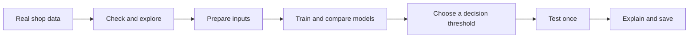
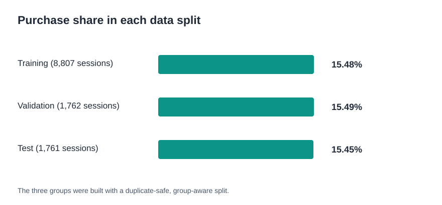
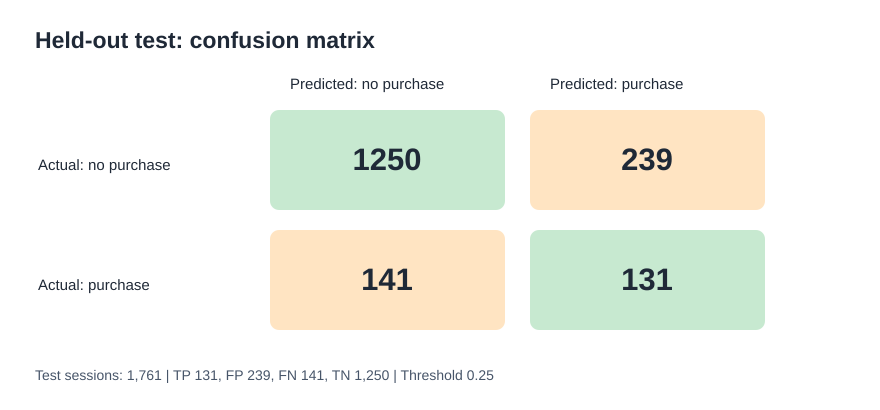
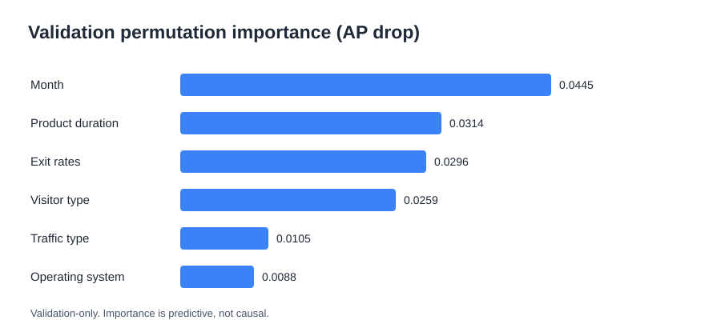

# ShopSense AI — Predicting Purchase Intent

**My first end-to-end machine learning portfolio project.**

I wanted to answer one simple question:

> Can a machine learning model use online shop session data to guess if a visitor will buy something?

I used real public data. I checked it, made charts, trained models, compared results, and tested my final model. I also made mistakes, checked what changed, and learned how to repeat my results.

**This is a learning project.** It is not a live website tool and it does not predict how much money a customer will spend.

## The project in one picture



## What I built

- **Data:** 12,330 shopping sessions; 1,908 ended with a purchase (15.47%).
- **Notebook:** [Open my complete notebook](notebooks/shopsense_ai.ipynb) — one notebook with code, notes, charts and results.
- **Models:** Logistic Regression and Random Forest. I tested different settings.
- **Best selected model:** Random Forest with 160 trees and minimum leaf size 5.
- **Decision threshold:** 0.25, chosen with validation data, before final testing.
- **Test result:** Average Precision **0.3913**, Precision **0.3541**, Recall **0.4816**, F1 **0.4081**.

I did not use `PageValues` in my main model. It may include information related to the purchase outcome. I wanted to avoid a result that looks good for the wrong reason.

## My results

| Measure | Test result | In simple words |
|---|---:|---|
| Average Precision | **0.3913** | How well my model ranks purchase sessions, with more focus on finding purchases |
| Precision | **35.41%** | When it predicts *purchase*, how often is it right? |
| Recall | **48.16%** | Of all real purchases, how many did it find? |
| F1 | **0.4081** | A balance of precision and recall |
| ROC-AUC | **0.7834** | How well the model ranks buyers above non-buyers overall |

**Important:** These are results on held-out historical sessions, not proof of business value or live performance. Model scores are not guaranteed calibrated probabilities.

### Charts from the real notebook run

**Purchase rates across the three split groups:**



**What happens when the model predicts on unseen test sessions:**



**Which inputs matter for this model (validation permutation importance):**



More figures: [Test metrics](outputs/test_metrics.svg) · [Purchase rates by split](outputs/purchase_rate_by_split.svg)

## My real try-and-error story

I did not get the same result on Google Colab the first time. This is what actually happened:

1. I ran the notebook in Colab. It worked, but my test Average Precision was **0.3407**, not **0.3913**.
2. I checked two CSV files. Both had 12,330 rows, but their file checksums were different.
3. I made sure I used the exact same CSV. The result **did not change**. So the CSV alone was not the answer.
4. I checked the library versions. Colab used **scikit-learn 1.6.1**, while the original run used **1.8.0**.
5. I installed **1.8.0**, restarted Colab, and ran the notebook again.
6. This time, the train/validation/test split, threshold and test metrics **all matched**.

I learned that **working code is not enough**. I must also check the data, library versions, and test setup.

[Read my learning journal →](docs/LEARNING_JOURNEY.md)

## Run it yourself in Google Colab

1. Open [Google Colab](https://colab.research.google.com/) and upload [`notebooks/shopsense_ai.ipynb`](notebooks/shopsense_ai.ipynb).
2. Run the first setup cell. It installs `scikit-learn==1.8.0`. **Restart the Colab session if it asks you to**, then run the notebook from the top.
3. The notebook can download the original UCI dataset if you have not uploaded it. Or upload `data/online_shoppers_intention.csv` to `/content/data/online_shoppers_intention.csv`.
4. Select **Runtime → Run all**. Read the text and charts as you go.
5. The model will be saved in `models/`, and the charts/results in `outputs/` (relative to the notebook's working directory, usually `/content` in Colab).

**Model file:** The trained binary is generated by the notebook. It is not stored in this GitHub repository; run the notebook to recreate it with the pinned scikit-learn version.

**Tip:** Colab files can disappear when a session ends. Download your finished notebook and the generated files before you close it.

For local Jupyter / VS Code, install `requirements.txt` from the project root and run the notebook. For a step-by-step beginner guide, see [START_HERE.md](docs/START_HERE.md).

## Project files

```text
ShopSense-AI/
├── notebooks/shopsense_ai.ipynb   # One complete notebook
├── data/                          # Original public dataset and source notes
├── models/                        # Regenerate the saved model by running the notebook
├── outputs/                       # Real numbers and charts
├── docs/                          # Easy guide, learning story and technical notes
├── requirements.txt               # Local tested library versions
└── README.md                      # This page
```

## What I learned

I learned to **ask a clear question**, **check data**, **avoid data leakage**, **split data before making choices**, **compare models**, **use validation for decisions**, and **test only after my choices are fixed**. I also learned that a result must be easy for another person to repeat.

I still need to learn more about time-based testing, probability calibration and real-world model monitoring. I will not call this a production-ready system.

## Documentation

- [Start here — very simple guide](docs/START_HERE.md)
- [My real learning journey and trial and error](docs/LEARNING_JOURNEY.md)
- [How to read my results](docs/RESULTS_EXPLAINED.md)
- [Model card — what this model can and cannot do](docs/MODEL_CARD.md)
- [Full technical notes and experiment table](docs/TECHNICAL_NOTES.md)
- [Dataset details and credits](data/README.md)
- [How to publish on GitHub](docs/PUBLISH_ON_GITHUB.md)

## Data credit

Data: *Online Shoppers Purchasing Intention Dataset*, Sakar & Kastro (2018), [UCI Machine Learning Repository](https://archive.ics.uci.edu/dataset/468/online+shoppers+purchasing+intention+dataset), [DOI 10.24432/C5F88Q](https://doi.org/10.24432/C5F88Q), **CC BY 4.0**. The [Kaggle mirror](https://www.kaggle.com/datasets/imakash3011/online-shoppers-purchasing-intention-dataset) was the original project idea; the measured results use the UCI data. The dataset CSV was normalized for text encoding/newlines, so its file checksum is not claimed to match the original download byte-for-byte.

*Built as a learning and portfolio project with AI-assisted coding and review. The steps, experiments, and results described here are based on actual notebook runs.*